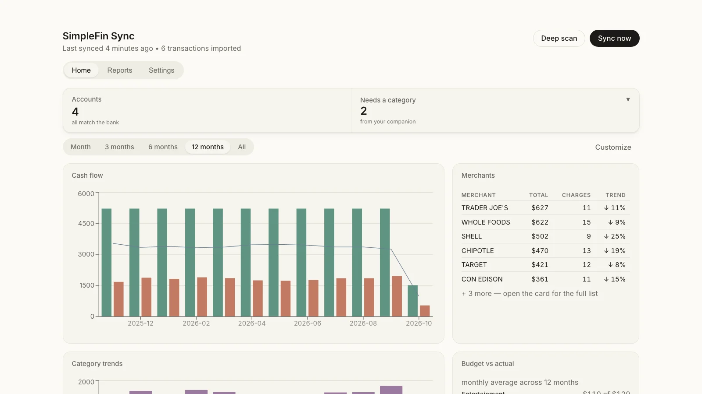

# SimpleFin Sync for Wealthfolio

Import your bank and credit-card transactions into
[Wealthfolio](https://wealthfolio.app) automatically, via
[SimpleFin](https://beta-bridge.simplefin.org) — a privacy-focused, read-only
bank aggregation service.

Your data goes from your bank to SimpleFin to your own Wealthfolio instance.
Nothing is sent anywhere else, and SimpleFin access is read-only: nothing can
move money.

<picture>
  <source media="(prefers-color-scheme: dark)" srcset="assets/cover-dark.webp">
  
</picture>

## Set up in three steps

1. Install the addon in Wealthfolio (**Settings → Add-ons**).
2. Open **SimpleFin Sync** in the sidebar and paste your SimpleFin setup token.
3. Pick the Wealthfolio account each bank account writes into.

That's it: saving the mapping runs the first sync and turns on auto-sync every
6 hours. Rules, the Telegram bot and Amazon categorization are optional, and
live in **Settings** when you want them.

You need Wealthfolio **3.6.2** or newer and a SimpleFin account with a one-time
**setup token**. The token is exchanged once for a long-lived access URL, kept
in Wealthfolio's encrypted secret storage; the token itself is not kept.

## What you get

The addon has three tabs: **Home**, **Reports** and **Settings**.

- **Home** — a status strip (last sync, accounts, anything that needs you),
  then your budget: six reports to start (headline numbers, cash flow or the
  semester-pool burn-down, budget vs actual, top merchants, subscriptions),
  with more a tap away under **+ Add report**, or build your own.
- **Syncing that gets the money right.**
  - Every SimpleFin account (checking, savings and cards) is imported on a
    schedule, with a catch-up when you open the app.
  - Pending charges are updated in place when they post, never duplicated.
  - A transfer between your own accounts, like a card payment, is linked
    as one movement and kept out of spending and income.
  - A one-time starting balance lands each account on the bank's real
    balance; any difference is flagged with a one-click fix.
- **Reports** (with the companion) — the daily, weekly and monthly reports
  as they stand right now, plus every edition that was sent. On a Wealthfolio
  server with Web Push, each report is also pushed to your devices.
- **Telegram bot** (with the companion) — one short daily report: what you
  spent, what's left, and a single "🧹 N things to fix" line with buttons.
  File transactions, check what you can afford and pull charts from the chat.
- **Amazon categorization** (optional) — reads Amazon's order emails from a
  throwaway mailbox and files each `AMAZON.COM*…` charge under what you bought.
- **Rules** — map a description pattern to a category or activity type when a
  bank's wording needs help. Your rules always win.

## Requirements

- Wealthfolio **3.6.2** or newer
- A SimpleFin account and a one-time **setup token**
- Optional: Docker, for the background companion (background sync, Reports,
  the Telegram bot and Amazon categorization)

### Adding or removing accounts later

Accounts you link at your SimpleFin bridge *after* setup are not synced until
they are mapped, because a mapping is what tells the sync which Wealthfolio
account to write into. Map them under **Settings → Accounts → Edit mapping**: it reads the
live account list from SimpleFin and lets you map each one to an existing
Wealthfolio account or create a new one. Nothing else you have configured is
touched — there is no need to run setup again.

Clearing an account's selection stops syncing it. Transactions already imported
into Wealthfolio stay; delete the Wealthfolio account itself if you want them
gone.

The addon does not let a newly-linked account go unnoticed: Home shows
a banner naming any SimpleFin account nothing is mapped to, and the companion
names it in the daily Telegram report (or, with the daily report off,
sends one notice per account the first time it sees it).

## How it works

### Syncing

A sync runs when you open Wealthfolio, on your chosen interval while a tab is
open, and whenever you press **Sync now**. A one-hour minimum interval acts as
a cooldown, so reloading the page is a cheap no-op.

Each run re-scans a two-week overlap rather than only new transactions, because
card purchases often post days later with a backdated timestamp. Transactions
are matched by their SimpleFin id, so re-scanning already-imported rows changes
nothing.

### Transfers, card payments & refunds

- Transfers between two mapped accounts (for example, paying a credit card from
  checking) are matched on equal amounts, opposite signs, within five days, and
  imported as a linked Transfer Out / Transfer In pair — excluded from both
  spending and income.
- Positive amounts on a credit-card account import as **Credit** (a refund,
  netted against spending) unless they look like a card payment — "payment",
  "autopay", "thank you", "e-pay" — which become Transfer In.
- Cash-transfer legs are deliberately imported with **no asset**, which is what
  lets Wealthfolio book the cash movement and pair the two legs. See
  `companion/upstream-pr.md` for the underlying upstream issue.

### Starting balances

On an account's first sync the addon reads its current balance from
Wealthfolio's valuations API and adds a one-time correction, so the account
lands on its real bank balance. For a brand-new account the valuation is
computed asynchronously after the first import, so the addon polls briefly and
applies the correction in the same run.

If a later wide re-scan recovers transactions older than that entry, the
baseline is adjusted by their total — otherwise those transactions would be
counted twice, once in the baseline and again individually — and moved to the
day before the earliest transaction, so the account's history never dips
below zero.

A credit card that started out owing money gets its opening debt as a
withdrawal, the only money-out type Wealthfolio accepts on a card. The Docker
companion files it under an **Opening balances** spending category and
excludes that category from spending, so Wealthfolio's Spending page does not
read it as a purchase.

### Deep scan

**Deep scan** (the header button; "reconcile & link" in the logs) re-scans a
wider window (about 90 days) to recover transactions an earlier sync missed,
re-checks each account against its SimpleFin balance, and links any transfer
pairs that aren't yet linked.

Two optional toggles:

- **Auto re-scan** (`auto-heal` in the logs) — run the wide re-scan on every
  sync. Balance corrections stay manual.
- **Aggressively auto re-scan** — additionally insert balance corrections
  automatically, at most one per account per day.

Balance corrections are written as a spending-neutral `CREDIT`, so they move
the balance without appearing as income or as spending in your budget.

### Background sync & Telegram notifications

Wealthfolio addons run while a browser tab is open. If you want data to
refresh automatically without keeping a browser tab open, or receive real-time
Telegram import alerts and native Spending Tracker budget breakdown reports,
run the optional companion container:

```bash
docker pull ghcr.io/bubbles840/wealthfolio-simplefin-sync:latest
```

The companion runs on the exact same shared sync core as the in-app addon. Account
mappings and credentials are configured directly in Wealthfolio via the addon UI,
so the companion container runs as a lightweight background daemon:

```yaml
services:
  simplefin-sync:
    image: ghcr.io/bubbles840/wealthfolio-simplefin-sync:latest
    restart: unless-stopped
    environment:
      - WEALTHFOLIO_API_URL=http://wealthfolio:8088   # Wealthfolio's default port
      - WEALTHFOLIO_PASSWORD=your_wealthfolio_password
      - WEALTHFOLIO_DB_PATH=/mnt/wealthfolio/wealthfolio.db
      - TZ=America/New_York          # Required, or schedules fire on UTC
    volumes:
      # Mount the FOLDER containing wealthfolio.db, not the .db file itself.
      # A file-only mount hides the -wal/-shm files beside it, so the companion
      # reads whatever was last checkpointed — observed two days stale.
      - /path/to/wealthfolio:/mnt/wealthfolio:ro
```

Images are published for `linux/amd64`, tagged `:latest` and `:vX.Y.Z`. To
upgrade:

```bash
docker compose pull simplefin-sync
docker compose up -d simplefin-sync
```

Pin `:vX.Y.Z` instead of `:latest` if you would rather upgrade deliberately.
The companion logs its version on startup (`Starting companion v…`), and the
addon shows a banner when the tab, the installed addon and the companion
are different versions, naming the fix (reload, upload the zip, or pull the image).

### Amazon auto-categorization

A bank charge reads `AMAZON.COM*MB3T81` and says nothing about what you bought.
Amazon's order emails name the category, so forwarding those to a mailbox the
companion can read lets it label each Amazon charge automatically:

```
Email:  Order 113-0728509 · 1 Lawn & Garden item · $21.18
Bank:   AMAZON.COM*MB3T81 · $21.18
   →    comment becomes "AMAZON.COM*MB3T81 · Amazon: Lawn & Garden · TRN-…"
   →    Wealthfolio's own rule files it under Housing
```

Set up in the **Amazon categorization** card on the Sync page (three fields).
No extra container: the mailbox is read at the start of each sync, which is the
only moment the data is used.

**Use a separate, empty mailbox.** No email provider offers a per-sender scope —
an app password grants the whole account — so instead of handing over your real
inbox, you add one filter forwarding `auto-confirm@amazon.com` and
`shipment-tracking@amazon.com` to a throwaway address that contains nothing but
receipts. If that password ever leaked, receipts are all it could reach, and you
revoke it by deleting one filter.

**It cannot double-count a purchase.** Order emails never create a transaction —
they only add text to the comment of a row SimpleFin already imported. An email
with no matching charge does nothing and is pruned after 90 days. Where two Amazon
orders share an amount inside the ±5 day window, neither is applied: an ambiguous
match is worse than none, since a wrong category is invisible while a missing one
surfaces in the needs-a-category sweep.

To check it works before waiting on a real order, forward one Amazon email to the
mailbox and run the read-only diagnostic — it marks nothing read and records
nothing, so the real poll still picks the message up:

```bash
docker exec simplefin-sync node dist/companion/src/amazon-check.js \
  --host imap.gmail.com --user you@gmail.com --password 'xxxx xxxx xxxx xxxx'
```

A Gmail app password (`myaccount.google.com/apppasswords`, with 2-Step
Verification on) is all the mailbox needs — there is no IMAP setting to enable,
since Google removed that toggle and IMAP is always on. Paste it as Google shows
it; the spaces are removed for you.

Three things trip up almost everyone setting this up:

- **The Gmail filter's _To_ field must be empty.** A filter with your address in
  _To_ matches nothing Amazon sends, so nothing is forwarded and nothing fails —
  the card just never sees an email. The card says so once the companion has
  checked the mailbox and found it empty.
- **Gmail only forwards mail that arrives after the filter exists.** Forward one
  old order email by hand to test, as above.
- **`AMAZON_IMAP_HOST`, `AMAZON_IMAP_USER`, `AMAZON_IMAP_PASSWORD` and
  `AMAZON_IMAP_PORT` in the companion's environment override the card.** Useful
  for keeping the password out of Wealthfolio; confusing if you forget they are
  set and then edit the card.

If the companion cannot sign in to the mailbox, the card shows the error itself
(before 1.57.0 it was only in `docker logs`).

**Proton Mail does not work for this**, for two reasons. An alias delivers into the
same mailbox, so credentials for it reach everything in the account — no isolation
at all. And Proton has no plain IMAP: it requires Proton Mail Bridge, which is a
paid, desktop-only app. Use a separate free Gmail or GMX account instead.

To change where a label files, use the dropdown on the Sync page and save — then
re-run the rules script, which re-points the existing rule rather than skipping it.

`companion/scripts/amazon-rules.mjs` needs Node and write access to the database, so
run it in a throwaway container rather than via `docker exec` into the companion —
the companion's database mount is read-only by design. Dry-run first (it is the
default), and **stop Wealthfolio before `--apply`**:

```bash
docker run --rm \
  -v /path/to/wealthfolio-dir:/db:ro \
  -v ~/wealthfolio-simplefin-addon/companion/scripts:/s:ro \
  -v /tmp/labels.json:/labels.json:ro \
  node:22-alpine node /s/amazon-rules.mjs --db /db/wealthfolio.db --labels /labels.json
```

Labels are matched by pattern rather than a lookup table, so a label Amazon
invents next month files itself. Anything unmatched goes to a configurable default
*and* is announced once in Telegram. `companion/scripts/amazon-rules.mjs` inserts
the matching Wealthfolio rules (dry-run by default).

**Itemization is not possible.** Amazon removed item names, quantities and unit
prices from these emails on 2026-07-08; only a category label, a total and an item
count remain. Splitting a charge into per-item rows needs per-item prices, so that
is dead at the source — which is also why category tagging is safe: with nothing
to split, reconciliation is never involved.

## Privacy

- SimpleFin access is **read-only**.
- Credentials live in Wealthfolio's encrypted secret storage and are never
  logged or included in error messages.
- Network access is restricted to the SimpleFin bridge hosts, declared in
  `manifest.json`.
- Amazon categorization is off unless configured, and reads only the mailbox you
  point it at — deliberately a throwaway one holding nothing but receipts.

## Development

```bash
npm install
npm test          # 1,556 tests (plus 703 in companion/)
npm run type-check
npm run bundle    # builds and zips to dist/
```

## License

MIT — see [LICENSE](LICENSE).
